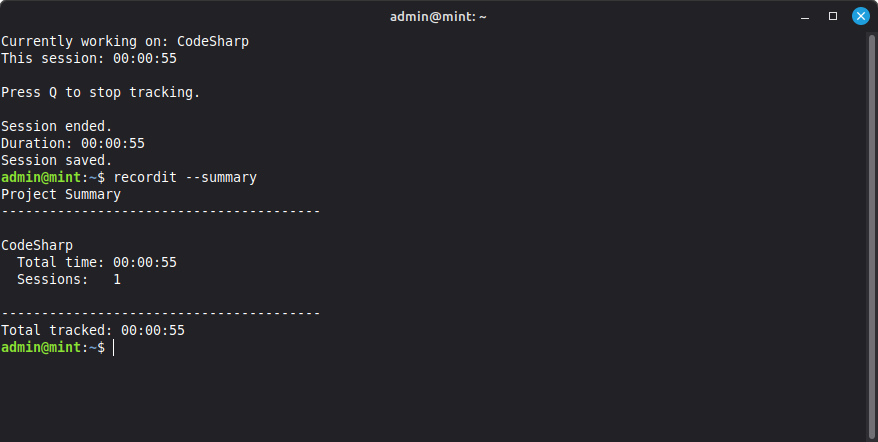

# Recordit

A small terminal application for tracking time worked on projects.



```text
### Commands

recordit <project\>  
recordit <command\> [arguments]  

\[Arguments\]  
<project\>                       Start tracking a project  
--summary                        Show total time for all projects  
--history <project\>             Show project session history  
--history <project\> <n\>        Show the last n sessions  
--delete <project\>              Delete all project sessions  
--delete <project\> <id\>        Delete a specific session  
--version, -v                    Show application version  
--help, -h                       Show this help message  

Press Q to stop the current session.
```
